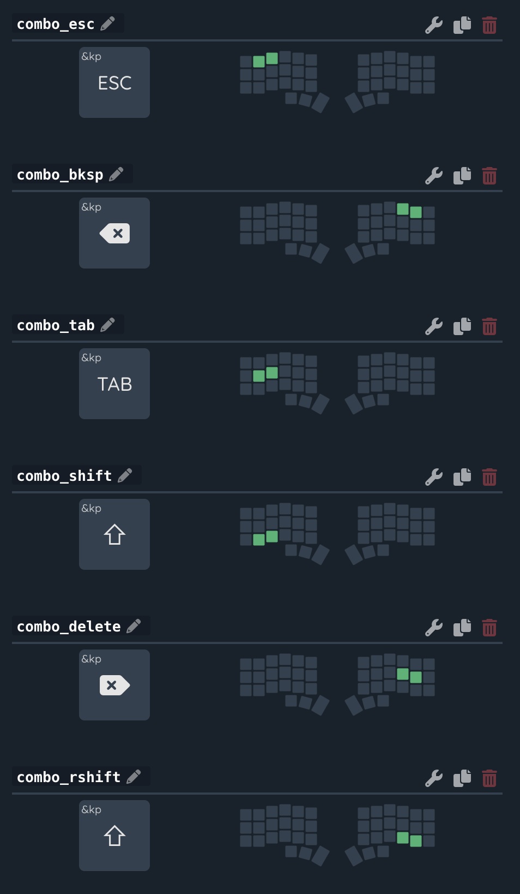
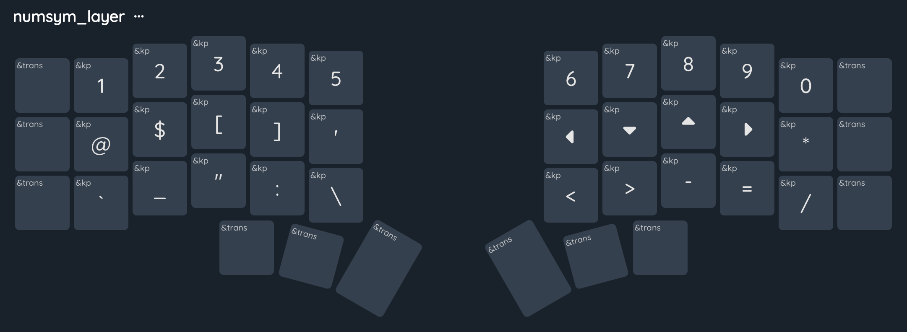
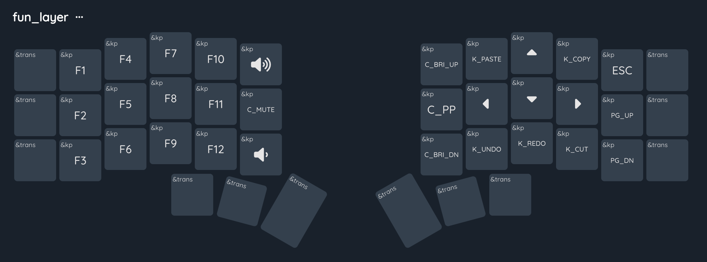
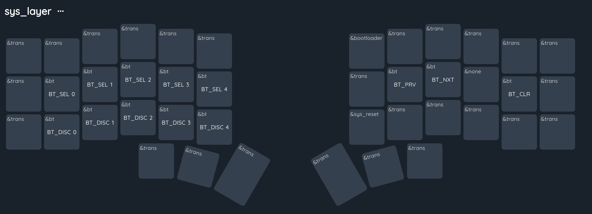

ZMK Corne untuk Super Mini / Promicro Wireless NRF52840.

[ZMK STUDIO](https://zmk.studio/)
Ada update baru ZMK Studio remapping tanpa perlu di flash 

[Full Dokumentasi ZMK](https://zmk.dev/docs)


Tools :
[ZMK Keymap Editor](https://nickcoutsos.github.io/keymap-editor/)
Video fork repository :
[Tutorial Mapping ZMK](https://youtu.be/cAi5pnkz48M)


Prosedur Reset Keyboard Split
Lakukan langkah-langkah berikut untuk mereset semua bagian keyboard split Anda:
- Masukkan setiap bagian keyboard split ke mode bootloader. Dengan cara tekan 2x tombol reset saat USB terhubung akan muncul drive baru, untuk flash nya cukup drag & drop di disk bootloader
- Flash salah satu bagian keyboard dengan firmware reset pengaturan setting_reset.uf2.
- Ulangi langkah 2 pada bagian lainnya dari keyboard split.
- Flash image firmware yang sebenarnya untuk setiap bagian keyboard split (misalnya my_board_left.uf2 untuk bagian kiri, my_board_right.uf2 untuk bagian kanan).
- Jika central dan peripheral tidak saling terhubung setelah menyelesaikan langkah-langkah ini, akan membantu untuk mereset central dan peripheral pada waktu yang hampir bersamaan. Biasanya dilakukan dengan menghubungkan pin reset ke ground pada setiap mikrokontroler keyboard Anda, menekan tombol reset, atau mematikan lalu menyalakan keduanya dengan sakelar daya.
- Setelah selesai, Anda harus menghapus/lupakan keyboard dari perangkat host mana pun yang sebelumnya terpasang, lalu lakukan pairing ulang, karena informasi pairing tersebut juga telah dihapus dari keyboard.
  

🔵 Penjelasan Bluetooth ZMK (Versi Sederhana)
Keyboard ZMK menggunakan sistem Bluetooth yang aktif secara otomatis. Pada layar keyboard, Anda akan melihat angka dan simbol yang menjelaskan status koneksi.

📌 1. Angka = Slot Bluetooth
Angka yang tampil di layar menunjukkan slot penyimpanan perangkat (Bluetooth Profile). <br>
Contoh: <br>
Angka 1 di layar = menggunakan BT_SEL 0 <br>
Angka 2 di layar = menggunakan BT_SEL 1 <br>
Dan seterusnya <br>
Setiap slot dapat menyimpan satu perangkat.


📌 2. Simbol “X”
Jika muncul ikon X, artinya:
Slot tersebut pernah digunakan, tetapi
Tidak sedang terhubung ke perangkat mana pun


📌 3. Pairing Ulang
Jika ingin melakukan pairing ulang untuk slot yang sedang dipakai:
Tekan tombol BT_CLR pada keymap
Layar akan berubah menjadi ikon gerigi (slot di-reset)
Lakukan pairing dari perangkat Anda
Jika berhasil, simbol akan berubah menjadi ikon centang


📌 4. Slot Tidak Bisa Ditimpa
Slot Bluetooth tidak bisa langsung ditimpa perangkat baru.
Jika slot tersebut sudah pernah terhubung ke perangkat lain, Anda harus:
Pindah ke slot lain (BT_SEL berikutnya), atau
Hapus slot dengan tombol BT_CLR

📌 5. Contoh Penggunaan Slot <br> 
Rekomendasi pembagian slot: <br>
BT_SEL 0 → PC <br>
BT_SEL 1 → Tablet <br>
BT_SEL 2 → Mac <br>
Dengan begitu, Anda hanya perlu mengganti slot saat berpindah perangkat.

NOTES !!!

Saat charging indicator di Board harus *Steady biru* (tidak blinking). fungsi slider memutuskan arus dari baterai ke MCU. Jadi saat charge posisi slider harus on

# 🖥️ Display OLED (zmk-nice-oled, tampilan vertikal)

Layar OLED 0.91" 128x32 memakai modul [zmk-nice-oled](https://github.com/mctechnology17/zmk-nice-oled) sehingga tampilannya vertikal.

- **Kiri (central):** output USB/BT, baterai, animasi WPM (Bongo Cat), indikator modifier (Ctrl/Shift/Alt/Gui), titik profil BT, dan nama layer.
- **Kanan (peripheral):** animasi (default: kucing).

## File yang terlibat

| File | Fungsi |
|---|---|
| `config/west.yml` | Menarik modul `zmk-nice-oled`. Di-pin ke commit `46f824abb2...`, yang diuji dengan ZMK `v0.3.0`. Jangan diganti ke `main` tanpa mengecek build. |
| `build.yaml` | Shield harus `corne_left nice_oled` dan `corne_right nice_oled`. |
| `config/corne.conf` | Semua parameter tampilan (lihat di bawah). |
| `config/corne.keymap` | `display-name` tiap layer, yang menjadi teks indikator layer di OLED. |

## Cara mengedit

1. Ubah parameter di `config/corne.conf`. Format: `CONFIG_NAMA=y` (aktif), `=n` (mati), atau angka.
2. Commit lalu push. GitHub Actions akan build otomatis.
3. Download artefak `firmware`, lalu flash `.uf2` ke sisi yang berubah. Parameter *central* hanya berlaku di kiri, *peripheral* hanya di kanan.

> ⚠️ **Wajib:** widget bawaan ZMK harus tetap `=n`. Kalau diaktifkan, build gagal dengan error `multiple definition of widget_..._status`.
> ```
> CONFIG_ZMK_WIDGET_BATTERY_STATUS=n
> CONFIG_ZMK_WIDGET_OUTPUT_STATUS=n
> CONFIG_ZMK_WIDGET_LAYER_STATUS=n
> CONFIG_ZMK_WIDGET_WPM_STATUS=n
> ```

> 💡 Nama layer di OLED diambil dari `display-name` di `corne.keymap`, maksimal sekitar 4 karakter karena lebar layar cuma 32px. Tanpa `display-name`, indikator layer kosong. Kalau layer di-rename lewat ZMK Studio, nama dari Studio yang dipakai.

## Contoh yang sering dipakai

**Menonaktifkan animasi kucing di kanan** dan menggantinya dengan gambar diam (lebih hemat baterai):
```
CONFIG_NICE_OLED_WIDGET_ANIMATION_PERIPHERAL=n
CONFIG_NICE_OLED_WIDGET_STATIC_IMAGE_PERIPHERAL=y
CONFIG_NICE_OLED_WIDGET_STATIC_IMAGE_PERIPHERAL_VIM=y
```

**Mengganti kucing dengan animasi lain.** Aktifkan hanya satu, yang lain `=n`:
```
CONFIG_NICE_OLED_WIDGET_ANIMATION_PERIPHERAL_CAT=n
CONFIG_NICE_OLED_WIDGET_ANIMATION_PERIPHERAL_SPACEMAN=y
```

**Mengganti Bongo Cat di kiri dengan Luna (anjing):**
```
CONFIG_NICE_OLED_WIDGET_WPM_BONGO_CAT=n
CONFIG_NICE_OLED_WIDGET_WPM_LUNA=y
```

**Simbol modifier gaya Windows** (default-nya simbol macOS ⌘ ⌥):
```
CONFIG_NICE_OLED_WIDGET_MODIFIERS_INDICATORS_FIXED_SYMBOL_WINDOWS=y
```

**Membalik warna** (latar putih, tulisan hitam):
```
CONFIG_NICE_OLED_WIDGET_INVERTED=y
```

**Menyembunyikan gambar/animasi di kanan.** Modul selalu menggambar sesuatu di kanan: kalau animasi dan gambar diam sama-sama mati, yang muncul kristal acak. Karena itu animasinya dimatikan (supaya hemat baterai) lalu gambarnya digeser keluar layar. Status baterai dan koneksi di kanan tetap tampil.
```
CONFIG_NICE_OLED_WIDGET_ANIMATION_PERIPHERAL=n
CONFIG_NICE_OLED_WIDGET_STATIC_IMAGE_PERIPHERAL=n
CONFIG_NICE_OLED_WIDGET_ANIMATION_PERIPHERAL_CUSTOM_Y=200
```

**Pokemon "diam" di kanan** (tidak dipakai lagi karena terlihat buggy). Modul tidak punya gambar diam Pokemon, jadi animasinya diperlambat. Ada 48 frame, sehingga 480000 ms berarti ganti gambar setiap 10 detik. Jangan lebih dari ~2000000, karena perhitungan animasi LVGL bisa overflow.
```
CONFIG_NICE_OLED_WIDGET_ANIMATION_PERIPHERAL_CAT=n
CONFIG_NICE_OLED_WIDGET_ANIMATION_PERIPHERAL_POKEMON=y
CONFIG_NICE_OLED_WIDGET_ANIMATION_PERIPHERAL_MS=480000
```

**Menyembunyikan indikator modifier di kiri:**
```
CONFIG_NICE_OLED_WIDGET_MODIFIERS_INDICATORS=n
```

**Menyembunyikan titik profil BT di kiri.** Tidak ada opsi on/off, jadi posisinya digeser keluar canvas (tinggi canvas 160px). Angka profil di sebelah ikon output tetap tampil. Untuk menyembunyikan angkanya juga, tambahkan `CONFIG_NICE_OLED_WIDGET_PROFILE_TEXT_CUSTOM_Y=200`.
```
CONFIG_NICE_OLED_WIDGET_PROFILE_CUSTOM_Y=200
```

> ❌ **Nama layer tidak bisa dipindah ke kanan.** Di ZMK v0.3, koneksi split dari kiri ke kanan hanya mengirim indikator HID (Caps/Num Lock), tidak mengirim status layer. Sisi kanan tidak tahu layer apa yang aktif.

**Memindahkan nama layer** kalau terpotong (koordinat dalam piksel):
```
CONFIG_NICE_OLED_WIDGET_LAYER_CUSTOM_Y=140
```

## Daftar parameter

Nilai default di bawah mengikuti `Kconfig.defconfig` di commit yang di-pin. Beberapa default berbeda dari README upstream.

### Umum (kiri & kanan)

| Parameter | Default | Keterangan |
|---|---|---|
| `CONFIG_ZMK_DISPLAY_STATUS_SCREEN_CUSTOM` | y | Wajib `y` agar layar nice_oled dipakai. |
| `CONFIG_NICE_OLED_ON` | y | Mode OLED. Jangan diubah. |
| `CONFIG_ZMK_DISPLAY_BLANK_ON_IDLE` | n (repo ini: **y**) | Matikan layar saat idle (`CONFIG_ZMK_IDLE_TIMEOUT`). Hemat baterai. |
| `CONFIG_NICE_OLED_WIDGET_INVERTED` | n | Balik warna. |
| `CONFIG_NICE_OLED_WIDGET_OUTPUT_BACKGROUND` | n | Latar belakang pada ikon output. |
| `CONFIG_NICE_OLED_SHOW_SLEEP_ART_ON_IDLE` | n | Gambar "sleep" saat idle. |
| `CONFIG_NICE_OLED_SHOW_SLEEP_ART_ON_SLEEP` | n | Gambar "sleep" saat deep sleep. |

### Kanan (peripheral)

| Parameter | Default | Keterangan |
|---|---|---|
| `CONFIG_NICE_OLED_WIDGET_ANIMATION_PERIPHERAL` | y | Aktifkan animasi. `n` = tanpa animasi. |
| `CONFIG_NICE_OLED_WIDGET_ANIMATION_PERIPHERAL_CAT` | y | Animasi kucing. |
| `CONFIG_NICE_OLED_WIDGET_ANIMATION_PERIPHERAL_GEM` | n | Animasi kristal. |
| `CONFIG_NICE_OLED_WIDGET_ANIMATION_PERIPHERAL_HEAD` | n | Animasi kepala. |
| `CONFIG_NICE_OLED_WIDGET_ANIMATION_PERIPHERAL_POKEMON` | n | Animasi Pokemon. |
| `CONFIG_NICE_OLED_WIDGET_ANIMATION_PERIPHERAL_SPACEMAN` | n | Animasi astronot. |
| `CONFIG_NICE_OLED_WIDGET_ANIMATION_PERIPHERAL_MS` | tergantung animasi | Durasi satu putaran animasi (ms). Makin besar, makin lambat. |
| `CONFIG_NICE_OLED_WIDGET_STATIC_IMAGE_PERIPHERAL` | y jika animasi mati | Gambar diam sebagai pengganti animasi. |
| `CONFIG_NICE_OLED_WIDGET_STATIC_IMAGE_PERIPHERAL_VIM` | n | Gambar diam logo Vim. |
| `CONFIG_NICE_OLED_WIDGET_STATIC_IMAGE_PERIPHERAL_VIP_MARCOS` | n | Gambar diam alternatif. |

### Kiri (central)

| Parameter | Default | Keterangan |
|---|---|---|
| `CONFIG_NICE_OLED_WIDGET_LAYER` | y | Indikator nama layer. |
| `CONFIG_NICE_OLED_WIDGET_PROFILE_BIG` | n | Indikator profil BT versi besar. |
| `CONFIG_NICE_OLED_WIDGET_WPM` | y | Widget WPM (induk dari opsi WPM di bawah). |
| `CONFIG_NICE_OLED_WIDGET_WPM_BONGO_CAT` | y | Animasi Bongo Cat yang bereaksi saat mengetik. |
| `CONFIG_NICE_OLED_WIDGET_WPM_BONGO_CAT_ANIMATION_MS` | 300 | Kecepatan frame Bongo Cat (ms). |
| `CONFIG_NICE_OLED_WIDGET_WPM_LUNA` | n | Animasi anjing Luna (jalan/lari sesuai kecepatan ketik). |
| `CONFIG_NICE_OLED_WIDGET_WPM_LUNA_ANIMATION_MS` | 300 | Kecepatan frame Luna (ms). |
| `CONFIG_NICE_OLED_WIDGET_WPM_NUMBER` | n | Tampilkan angka WPM. |
| `CONFIG_NICE_OLED_WIDGET_WPM_SPEEDOMETER` | n | Speedometer WPM. |
| `CONFIG_NICE_OLED_WIDGET_WPM_GRAPH` | n | Grafik WPM. |
| `CONFIG_NICE_OLED_WIDGET_WPM_GRAPH_FIXED_RANGE_MAX` | 100 | Batas atas speedometer/grafik. |
| `CONFIG_NICE_OLED_WIDGET_MODIFIERS_INDICATORS` | y | Indikator modifier (Ctrl/Shift/Alt/Gui). |
| `CONFIG_NICE_OLED_WIDGET_MODIFIERS_INDICATORS_FIXED_SYMBOL` | y | Gaya ikon. Alternatifnya `..._FIXED_LETTER=y` untuk huruf C S A G. |
| `CONFIG_NICE_OLED_WIDGET_MODIFIERS_INDICATORS_FIXED_SYMBOL_MACOS` | y | Ikon macOS. Alternatifnya `..._FIXED_SYMBOL_WINDOWS=y`. |
| `CONFIG_NICE_OLED_WIDGET_MODIFIERS_INDICATORS_FIXED_BOX` | y | Susunan kotak 2x2. Alternatifnya `..._FIXED_HOR=y` (satu baris) atau `..._FIXED_VER=y` (bertumpuk). |
| `CONFIG_NICE_OLED_WIDGET_MODIFIERS_INDICATORS_LUNA` | n | Modifier ditampilkan lewat animasi Luna. |
| `CONFIG_NICE_OLED_WIDGET_HID_INDICATORS` | y | Indikator Caps Lock/Num Lock dari host. |
| `CONFIG_NICE_OLED_WIDGET_HID_INDICATORS_LUNA` | n | Indikator HID lewat animasi Luna. |
| `CONFIG_NICE_OLED_WIDGET_HID_INDICATORS_BONGO_CAT` | n | Indikator HID lewat animasi Bongo Cat. |
| `CONFIG_NICE_OLED_WIDGET_CENTRAL_SHOW_BATTERY_PERIPHERAL_ALL` | n | *(eksperimental)* Tampilkan baterai kiri dan kanan. Butuh `CONFIG_ZMK_SPLIT_BLE_CENTRAL_BATTERY_LEVEL_FETCHING=y`. |
| `CONFIG_NICE_OLED_WIDGET_RAW_HID` | n | Jam, volume, layout, dan cuaca dari PC. Butuh aplikasi host `zmk-hid-host` yang berjalan di komputer. |

### Posisi widget (lanjutan)

Setiap widget punya `CONFIG_NICE_OLED_WIDGET_<NAMA>_CUSTOM_X` dan `_CUSTOM_Y` (piksel). `<NAMA>` bisa `LAYER`, `BATTERY`, `PROFILE`, `OUTPUT_USB`, `OUTPUT_BT`, `MODIFIERS`, `BONGO_CAT`, `LUNA`, `HID_INDICATORS`, atau `ANIMATION_PERIPHERAL`. Daftar lengkap dan nilai default-nya ada di [`Kconfig.defconfig`](https://github.com/mctechnology17/zmk-nice-oled/blob/46f824abb2bd41f1287c5c68abd14122af6042a3/boards/shields/nice_oled/Kconfig.defconfig).

> Jangan aktifkan `CONFIG_NICE_OLED_WIDGET_CENTRAL` / `CONFIG_NICE_OLED_WIDGET_PERIPHERAL`. Itu widget *test* dari pembuat modul.

## Kembali ke tampilan horizontal bawaan ZMK

1. Di `build.yaml`, hapus `nice_oled` dari shield (`corne_left`, `corne_right`).
2. Di `config/corne.conf`, beri `#` pada blok `### untuk Display`, lalu set `CONFIG_ZMK_WIDGET_*` kembali ke `=y`.
3. Di `config/west.yml`, project `zmk-nice-oled` boleh dibiarkan atau dikomentari.

# corne-zmk-5-column

## Chillmin Layout

# Introduction to chillmin Layout


## Layout philosophy

- familiar design for the qwerty alphas
- convinience is priority and minimal by design 
- uses only 36 keys 


## Base layer and mods

- The CM Layout has 5x3 keys per hand so we can only fit 
 the main alphabets so we need to use other ZMK features to fit our mod keys.

- We use side two key as combos for the side bar keys




### Number and Symbols Layer 


- Here we have both num pad and num row
- Rest of the symbols with some repeats 
- Design for keeps same use case keys closer.

## Fun layer



## System layer



